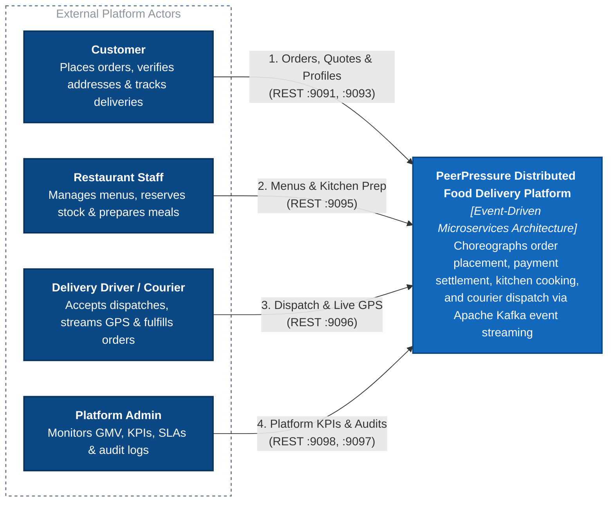
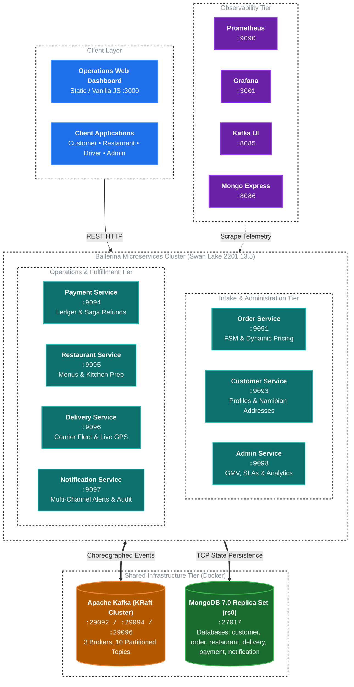
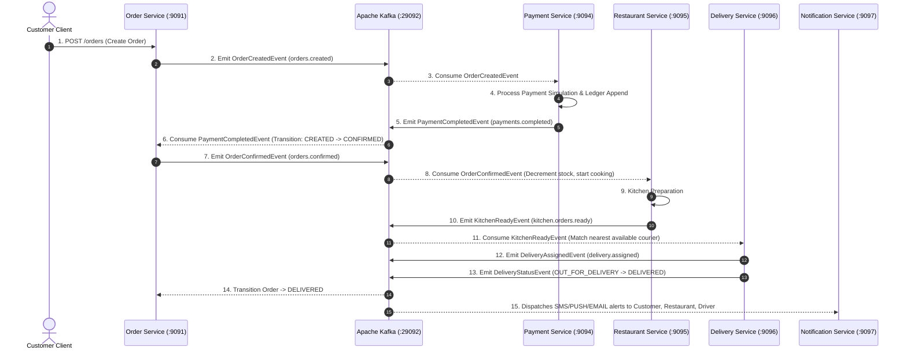

# Distributed Food Delivery Platform (Event-Driven Microservices)

[](https://github.com/CodeGrogu/DSA-Assignment-2/actions/workflows/ci.yml)
[](https://github.com/CodeGrogu/DSA-Assignment-2/actions/workflows/codeql.yml)
[](https://linear.app/peerpressure/project/distributed-food-delivery-platform-event-driven-microservices-83327d689776)
[](https://ballerina.io/)
[](https://kafka.apache.org/)
[](https://www.mongodb.com/)

A distributed, reactive food delivery platform engineered with **Ballerina Swan Lake**, **Apache Kafka (KRaft mode 3-broker cluster)**, and **MongoDB 7.0 Replica Set** by the **Peer Pressure** team for **DSA612S: Distributed Systems & Applications (Assignment 2)**. 

The system implements choreographed event-driven sagas, dynamic surge pricing with Civil Solar time offsets (CAT = UTC+2), finite state machine (FSM) validation, dual-mode persistent and in-memory storage, geospatial driver dispatch, double-entry financial ledger accounting, and multi-channel alerting.

---

## 1. System Architecture & C4 Topology

### 1.1 C4 Level 1: System Context Diagram



### 1.2 C4 Level 2: Container Topology & Infrastructure



### 1.3 Event Choreography Lifecycle



---

## 2. Zero-Collision Port Allocation Scheme

To prevent network port collisions between local host processes, Docker infrastructure, and microservices on developer workstations, all endpoints are mapped strictly according to the following registry:

| Component / Service | Internal Port | Host Port | Protocol | Purpose & Collision Safeguard |
| :--- | :---: | :---: | :---: | :--- |
| **Kafka Broker 1 (Host Listener)** | `29092` | `29092` | PLAINTEXT_HOST | Avoids collision with standard host Kafka port 9092 |
| **Kafka Broker 2 (Host Listener)** | `29094` | `29094` | PLAINTEXT_HOST | Second broker in 3-broker KRaft cluster |
| **Kafka Broker 3 (Host Listener)** | `29096` | `29096` | PLAINTEXT_HOST | Third broker in 3-broker KRaft cluster |
| **Kafka UI Dashboard** | `8080` | `8085` | HTTP | Web management dashboard for topics and consumer groups |
| **MongoDB 7.0 Primary (rs0)** | `27017` | `27017` | TCP | Replica set document storage for all entity collections |
| **Mongo Express UI** | `8081` | `8086` | HTTP | Interactive MongoDB web explorer (`root`/`password`) |
| **Prometheus Telemetry** | `9090` | `9090` | HTTP | Time-series scraper scraping `/metrics` on all 7 services |
| **Grafana Dashboards** | `3000` | `3001` | HTTP | Observability dashboard (`admin`/`admin`) |
| **Order Service** | `9091` | `9091` | HTTP REST | Order intake, state machine, and customer query API |
| **Customer Service** | `9093` | `9093` | HTTP REST | Customer profile, addresses, and order history |
| **Payment Service** | `9094` | `9094` | HTTP REST | Payment simulation, transaction ledger, and refunds |
| **Restaurant Service** | `9095` | `9095` | HTTP REST | Menu catalog, operating hours, and stock management |
| **Delivery Service** | `9096` | `9096` | HTTP REST | Driver matching, dispatching, and tracking lifecycle |
| **Notification Service** | `9097` | `9097` | HTTP REST | Multi-channel alert dispatching and audit log API |
| **Admin Service** | `9098` | `9098` | HTTP REST | Platform analytics, GMV calculation, and SLA breach reports |
| **Admin Web Dashboard** | `3000` | `3000` | HTTP | Lightweight operations front-end dashboard |

---

## 3. Kafka Topic Taxonomy & Schema Registry

Event records are defined in the shared contract library `peerpressure/events:0.1.0` in [`modules/events`](modules/events).

| Topic Name | Partitions | Key Strategy | Emitted By | Primary Consumers | Event Record Type |
| :--- | :---: | :--- | :--- | :--- | :--- |
| `orders.created` | 3 | `customerId` | Order Service | Payment Service, Notification Service | `OrderCreatedEvent` |
| `orders.confirmed` | 3 | `orderId` | Order Service | Restaurant Service, Notification, Admin | `OrderConfirmedEvent` |
| `orders.cancelled` | 3 | `orderId` | Order Service | Payment Service (Refunds), Notification | `OrderCancelledEvent` |
| `payments.completed` | 3 | `orderId` | Payment Service | Order Service | `PaymentCompletedEvent` |
| `payments.failed` | 3 | `orderId` | Payment Service | Order Service (Abort FSM), Notification | `PaymentFailedEvent` |
| `orders.preparing` | 3 | `restaurantId`| Restaurant Service | Order Service, Notification Service | `KitchenPreparingEvent` |
| `kitchen.orders.ready` | 3 | `orderId` | Restaurant Service | Delivery Service (Driver Dispatch) | `KitchenReadyEvent` |
| `delivery.assigned` | 3 | `driverId` | Delivery Service | Order Service, Notification Service | `DeliveryAssignedEvent` |
| `delivery.status` | 3 | `orderId` | Delivery Service | Order Service, Notification, Admin | `DeliveryStatusUpdateEvent` |
| `notifications.dispatched` | 3 | `recipientId` | Notification Service | Audit Logger, Admin Analytics | `NotificationEvent` |

---

## 4. Canonical Platform Seed Data & Overriding Architecture

The platform includes canonical, production-grade seed datasets modeling the real-world operational domain in **Windhoek and Swakopmund, Namibia**.

### 4.1 Seed Datasets Overview (`data/`)

| File Path | Target Database & Collection | Records | Description |
| :--- | :--- | :---: | :--- |
| [`data/seed_customers.json`](data/seed_customers.json) | `customer_db.customers` | 10 | Customer profiles with verified Windhoek delivery addresses, phone numbers, and GeoJSON 2dsphere points. |
| [`data/seed_restaurants.json`](data/seed_restaurants.json) | `restaurant_db.restaurants` | 5 | Iconic Namibian restaurants (Kapana Corner, Namibian Potjie Kitchen, Oshakati Kitchen, Braai House, Desert Cafe) with categorized menus, dietary tags, stock levels, and coordinates. |
| [`data/seed_drivers.json`](data/seed_drivers.json) | `delivery_db.drivers` | 8 | Active couriers across motorcycle, car, bicycle, and van fleets with live GPS positions in Windhoek. |
| [`data/seed_orders.json`](data/seed_orders.json) | `order_db.orders` | 10 | Orders across lifecycle statuses (`CREATED`, `CONFIRMED`, `PREPARING`, `READY`, `OUT_FOR_DELIVERY`, `DELIVERED`, `CANCELLED`). |
| [`data/seed_deliveries.json`](data/seed_deliveries.json) | `delivery_db.deliveries` | 5 | Active and historical delivery tracking tasks linked to drivers and orders with transit breadcrumbs. |
| [`data/seed_payments.json`](data/seed_payments.json) | `payments_db.payments` & `payment_db.payments` | 9 | Financial transactions in NAD with idempotency keys and statuses (`COMPLETED`, `REFUNDED`). |
| [`data/seed_notifications.json`](data/seed_notifications.json) | `notification_db.notifications` | 5 | Compliance audit records across SMS, PUSH, and EMAIL channels. |
| [`data/seed_platform.json`](data/seed_platform.json) | Consolidated Master File | All | Single master JSON containing the complete platform snapshot across all 7 microservices. |
| [`services/admin_service/seed_data.json`](services/admin_service/seed_data.json) | Admin Analytics Loader | 24 | Analytical fixture loaded by Admin Service for executive KPI calculations. |

### 4.2 The "Override Regardless" Invariant

In distributed systems testing, accumulated or corrupt state from interrupted runs causes subtle cascading failures. To solve this, the seed mechanism enforces an **unconditional override invariant**:

1. **Purge Prior State**: Existing documents in target collections are wiped unconditionally via `deleteMany({})`.
2. **Bulk Insertion**: Canonical seed records are inserted in bulk.
3. **Index Re-provisioning**: 2dsphere spatial indexes (for geospatial queries) and unique constraint indexes are verified and re-applied.
4. **Guaranteed Idempotence**: Running the seeder 1 time or 100 times always leaves all databases in the exact identical canonical state.

### 4.3 How to Run the Overriding Seed Data

#### Option 1: One-Shot Master Platform Seeder (Recommended)
From the repository root on your local workstation (with MongoDB running on `localhost:27017`):
```bash
mongosh -u root -p password --authenticationDatabase admin scripts/seed-platform.js
```

#### Option 2: Run Seeder Directly Inside Docker Container
If `mongosh` is not installed on your local host, execute the seeder inside the running MongoDB container:
```bash
docker exec -i dsa-mongodb mongosh -u root -p password --authenticationDatabase admin < scripts/seed-platform.js
```

#### Option 3: Customer-Specific Seeder
To seed or reset only `customer_db.customers`:
```bash
mongosh -u root -p password --authenticationDatabase admin scripts/seed-customers.js
```

#### Option 4: In-Service Auto-Seeding
When `restaurant_service` boots up, its `seedDatabase()` function automatically resets `restaurant_db.restaurants` with canonical menus and stock levels.

---

## 5. End-to-End Actor Simulation Workflows

### 5.1 The Customer Workflow
1. **Verify Delivery Address**:
   ```bash
   curl -X POST http://localhost:9093/customers/verifyAddress \
     -H "Content-Type: application/json" \
     -d '{"customerId":"CUST-001","address":{"street":"12 Independence Avenue","city":"Windhoek","state":"Khomas","postalCode":"10005","location":{"type":"Point","coordinates":[17.0658,-22.5609]}}}'
   ```
2. **Request Dynamic Surge Quote**:
   ```bash
   curl "http://localhost:9091/pricing/quote?unfulfilledOrders=40&availableDrivers=10"
   ```
3. **Place Order**:
   ```bash
   curl -X POST http://localhost:9091/orders \
     -H "Content-Type: application/json" \
     -d '{"customerId":"CUST-001","restaurantId":"R001","items":[{"itemId":"M1","name":"Beef Kapana","quantity":2,"price":50.00}],"deliveryAddress":{"street":"12 Independence Avenue","city":"Windhoek","state":"Khomas","postalCode":"10005"}}'
   ```
4. **Track Live Order & Delivery Status**:
   ```bash
   curl http://localhost:9091/orders/{orderId}
   curl http://localhost:9096/delivery/track/{orderId}
   ```

### 5.2 The Restaurant Workflow
1. **Browse Restaurant Catalog & Menus**:
   ```bash
   curl http://localhost:9095/restaurants/R001/menu
   ```
2. **Update Kitchen Cooking State**:
   ```bash
   curl -X POST http://localhost:9095/restaurants/R001/orders/{orderId}/prepare
   curl -X POST http://localhost:9095/restaurants/R001/orders/{orderId}/ready
   ```

### 5.3 The Delivery Driver Workflow
1. **Update Courier Transit State**:
   ```bash
   curl -X POST http://localhost:9096/deliveries \
     -H "Content-Type: application/json" \
     -d '{"orderId":"{orderId}","driverId":"drv_001","status":"OUT_FOR_DELIVERY","currentLocation":{"latitude":-22.5609,"longitude":17.0658}}'
   ```
2. **Query Driver Location & Status**:
   ```bash
   curl http://localhost:9096/delivery/track/{orderId}
   ```

### 5.4 The Platform Admin Workflow
1. **Inspect Platform KPIs & Financials**:
   ```bash
   curl http://localhost:9098/admin/stats/overview
   ```
2. **Audit Dispatched Notifications**:
   ```bash
   curl http://localhost:9097/notifications
   ```
3. **Launch Operations Web Dashboard**:
   Open [`web/admin_dashboard/index.html`](web/admin_dashboard/index.html) in your browser or run:
   ```bash
   python -m http.server 3000 -d web/admin_dashboard
   ```
   Visit [http://localhost:3000](http://localhost:3000) for real-time KPI cards and service health indicators.

---

## 6. Local Development & Quickstart

### 6.1 Prerequisites
- [Ballerina Swan Lake](https://ballerina.io/downloads/) `2201.13.5`
- [Docker & Docker Compose](https://docs.docker.com/compose/)
- Python 3

### 6.2 Step 1: Start Shared Infrastructure
```bash
docker compose -f docker-compose.infra.yml up -d
```
Verify infrastructure:
- **Kafka UI:** [http://localhost:8085](http://localhost:8085)
- **Mongo Express:** [http://localhost:8086](http://localhost:8086) (`root` / `password`)
- **Prometheus:** [http://localhost:9090](http://localhost:9090)
- **Grafana:** [http://localhost:3001](http://localhost:3001) (`admin` / `admin`)

### 6.3 Step 2: Seed the Databases
```bash
docker exec -i dsa-mongodb mongosh -u root -p password --authenticationDatabase admin < scripts/seed-platform.js
```

### 6.4 Step 3: Build & Launch Microservices
```bash
# Compile Ballerina workspace
bal build

# Launch containers
docker compose -f docker-compose.infra.yml -f docker/docker-compose.services.yml up -d --build
```

### 6.5 Step 4: Health Check Sweep
```bash
# Verify all 7 services report UP
curl http://localhost:9091/health
curl http://localhost:9093/health
curl http://localhost:9094/health
curl http://localhost:9095/health
curl http://localhost:9096/health
curl http://localhost:9097/health
curl http://localhost:9098/health
```

---

## 7. Team Attribution & Subsystem Ownership Matrix

**Organisation:** Peer Pressure | **Course:** DSA612S (Distributed Systems & Applications)  
**Institution:** Namibia University of Science and Technology (NUST)

| Team Member | Student ID | GitHub Handle | Service / Domain Ownership | Milestone | Parents | Subtasks | Pull Requests | Linear Keys |
| :--- | :---: | :--- | :--- | :---: | :---: | :---: | :---: | :---: |
| **Jaden Awaseb** (Team Leader) | `224055054` | `@CodeGrogu` | **Order Service** & Monorepo Architecture | M1, M2, M4, M5 | #1 - #5 | #41 - #50 | #121 - #125 | `PEE-187`-`PEE-191` |
| **Henry Heita** | `223013692` | `@Henchoz` | **Kafka Infrastructure**, DLQ & Chaos | M1, M3, M4, M5 | #6 - #10 | #51 - #60 | #126 - #130 | `PEE-192`-`PEE-193`, `PEE-74`-`PEE-76` |
| **Florinda Immanuel** | `224082256` | `@Florriinnddaa` | **Customer Service** & MongoDB Persistence | M1, M2, M3, M5 | #11 - #15 | #61 - #70 | #131 - #135 | `PEE-77`-`PEE-81` |
| **Tapiwa Machekera** | `224059483` | `@Jerganov` | **Restaurant Service** & Kitchen Processing | M1, M2, M3, M5 | #16 - #20 | #71 - #80 | #136 - #140 | `PEE-82`-`PEE-86` |
| **Kondwani Kunkwenzu** | `224093894` | `@Kondwani112206`| **Payment Service**, Ledger & Saga Refunds | M1, M2, M4, M5 | #21 - #25 | #81 - #90 | #141 - #145 | `PEE-87`-`PEE-91` |
| **May-Lee Mulundu** | `223087858` | `@itsyagirlmay` | **Delivery Service** & Driver Dispatch | M1, M3, M4, M5 | #26 - #30 | #91 - #100 | #146 - #150 | `PEE-92`-`PEE-96` |
| **Liina Massipa** | `223114006` | `@LiinaMassipa` | **Notification Service** & Admin Analytics | M1, M3, M4, M5 | #31 - #35 | #101 - #110 | #151 - #155 | `PEE-97`-`PEE-101` |
| **Nangukuii Kangootui** | `224031066` | `@Nangukuii` | **E2E Testing**, Docker Compose & Defense | M1, M4, M5 | #36 - #40 | #111 - #120 | #156 - #160 | `PEE-102`-`PEE-106` |
